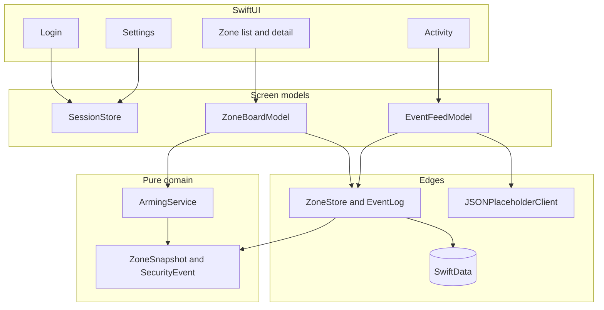

# SentinalX architecture

SentinalX is a security-monitoring companion. The screen shows zones, sensor readings, and a live activity feed. The decisions that matter — whether a zone may arm, and what Home, Away, and Disarm mean — do not live in the views or in SwiftData.

## Shape

Dependency direction is one way. Views talk to screen models. Screen models talk to the arming service, the stores, and the feed client. The domain types do not import SwiftUI, SwiftData, or URLSession.

`AppModel` is the composition root. It is the only place that knows to use SwiftData and JSONPlaceholder together. Previews pass an in-memory store and a stub client instead.

## UI (Lab 01)

`SentinalX/Design/AppButton.swift`, `AppCard.swift`, `AppSheet.swift`, and `AppTextField.swift` are copied from the Lab 01 **SwiftUIComponentLibrary** project and restyled with `Theme.swift` (`SX` tokens). Login, zone cards, metric tiles, settings confirms, and primary actions call these types. Monitoring-only views (`StatusPill`, `ChipRow`, `RingGauge`, `PINEntrySheet`) remain SentinalX-specific.

## Arming

`ArmingService` is a value type. `arm`, `disarm`, and `apply` take snapshots in and return new snapshots. They never mutate the caller's array, and they never open the database.

That split is what makes the XCTest target useful. The tests construct zones, call the service, and compare results. They do not boot SwiftData, the simulator UI, or the network.

The rules, in short:

- A zone arms only when it is online, sealed, closed (for contact sensors), and at or above a 20% battery. Motion sensors do not have a contact.
- Faults are ordered: offline, then tamper, then an open contact, then low battery. Arming reports the first one.
- Disarming always asks for the panel PIN, including when the sensor is open. You have to be able to stand a zone down to deal with it.
- Home arms healthy entry and perimeter zones and turns interior zones off. Away arms every healthy zone. A faulted zone is forced off and listed as skipped, so the rest of the site can still arm.
- Disarming the whole site asks for the PIN only when something is actually armed. A wrong PIN returns a failure and no new layout.
- The badge on the zone list is derived from the zones. It is not stored. Mixed switches show as Custom.

`ZoneBoardModel` is the thin layer around that. It calls the service, and only on success asks `ZoneStore` to save and `EventLog` to append a panel event.

## What is stored where

| Data | Where | Why |
| --- | --- | --- |
| Zones and their latest readings | SwiftData `ZoneRecord` | The assignment's local store. The list is sorted by `sortIndex`. |
| Panel and cloud events | SwiftData `EventRecord` | One log for both sources. Cloud rows are deduped by the JSONPlaceholder post id and capped at 60. |
| Sign-in, display name, PIN, feed interval, appearance | `UserDefaults` via `SessionStore` | Device preference, not monitoring history. |

The SwiftData container is local only (`cloudKitDatabase: .none`). Records are an edge format: raw strings go in, `ZoneSnapshot` and `SecurityEvent` come out. A screen never holds a `@Model` object.

The disarm PIN is a demo value in `UserDefaults`. A shipping app would put it in the Keychain. The sign-in password is not stored at all; the mock check compares it to `sentinal` and then remembers only that the operator is signed in.

## The live feed

`EventFeedClient` is the network seam. `JSONPlaceholderClient` pages `https://jsonplaceholder.typicode.com/posts` with `_start` and `_limit`. No key, no account.

`EventFeedModel` polls with `async`/`await` while the Activity tab is open and the live feed is on. Each page is mapped onto the current zone names, given a severity from the post id, and inserted one row at a time so the list moves. The cursor is remembered, so the next poll asks for the next page instead of the same four posts. Duplicates are dropped. If the host does not answer, the screen keeps the events already saved.

## Screens

`RootView` shows the login until `SessionStore` says the operator is signed in. After that, a sidebar-adaptable `TabView` holds three `NavigationStack`s:

- Zones pushes a zone id into `ZoneDetailView`.
- Activity is the feed.
- Settings edits preferences and can restore the demo.

Login stays outside the stack on purpose. Signing out should not be a back button into a form that still holds the password.

The visual system is in `Theme.swift` and `Components.swift`: one palette that adapts to light and dark, shared cards, pills, gauges, and the PIN sheet. Armed and disarmed are amber and green, with a lock icon, everywhere a zone status appears.

## Tests

`SentinalXTests/ArmingServiceTests.swift` covers single-zone arm and disarm, fault priority, the battery floor, Home and Away including skipped faults, PIN failures that must not change the layout, and the four postures. One test locks the seeded demo to Home, with the kitchen window on low battery and the back gate open.

The feed client and SwiftData are not unit-tested. Their behavior is visible in the walkthrough: pull to refresh, then relaunch and confirm the same zones and events are still there.
