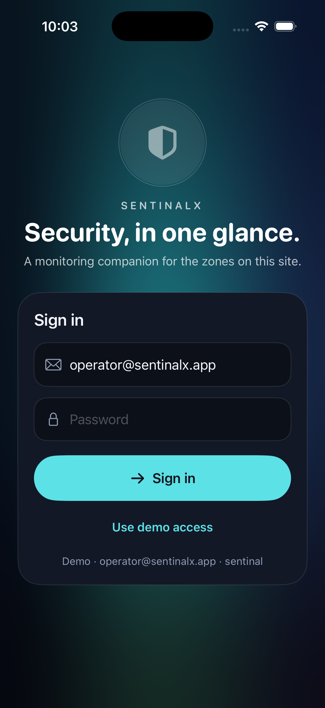
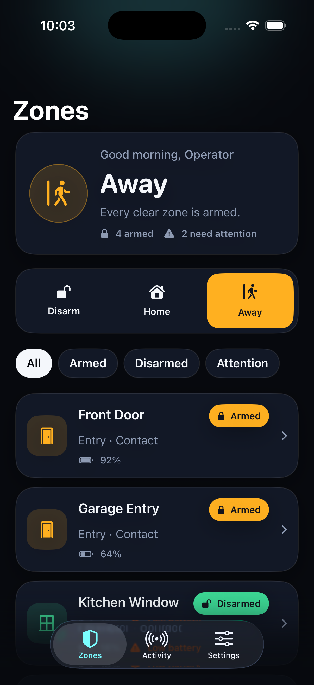
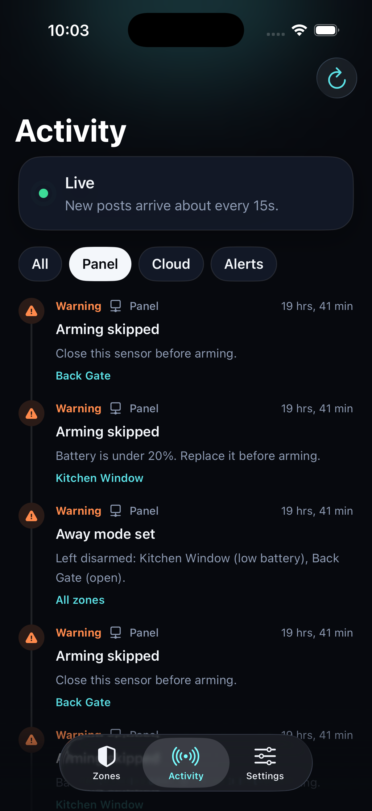
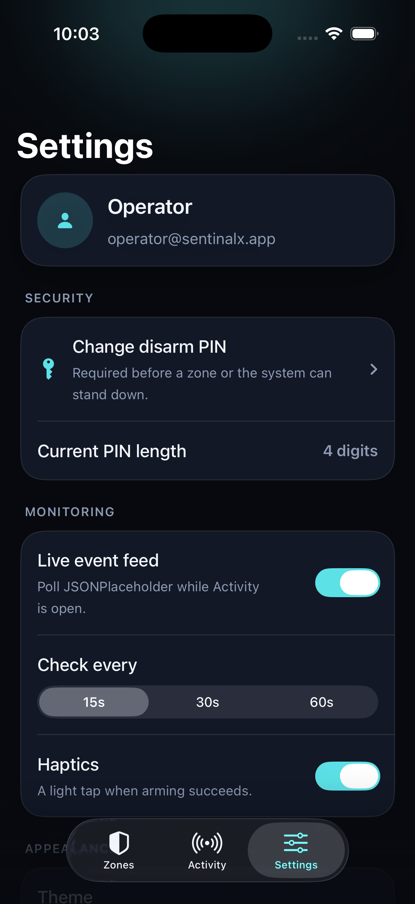
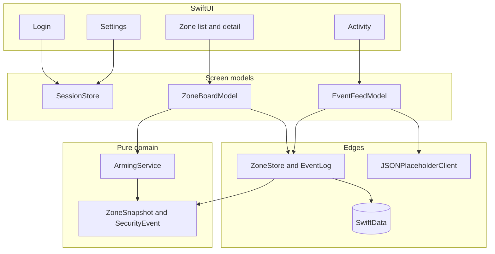

# SentinalX

SentinalX is a security monitoring companion for one small site. You sign in, see which doors and rooms are armed, open a zone for its sensor and battery readings, and watch an activity feed that mixes actions taken on this device with posts from a free mock API.

Zones and events are stored on the device with SwiftData. Arm and disarm decisions live in a pure Swift type and are covered by XCTest. The sign-in screen is a mock. Nothing here talks to a real alarm panel.

## Screens

Screenshots live in [`docs/screenshots`](docs/screenshots). They are documentation only. They sit outside the `SentinalX` app folder so Xcode does not copy them into the app.

| Sign in | Zones |
| :---: | :---: |
|  |  |

| Activity | Settings |
| :---: | :---: |
|  |  |

**Sign in.** Email and password. The demo account is printed on the card. **Use demo access** fills both fields and signs in.

**Zones.** The card at the top is the site posture: Disarmed, Home, Away, or Custom. Under it, Disarm, Home, and Away are action buttons for every zone at once. They are not navigation tabs. Each row shows an icon, Armed or Disarmed, and the battery. Attention means the zone cannot be armed until something is fixed.

**Zone detail.** Tap a row. The screen shows battery, contact or motion, signal, temperature, and the last check-in. Arm is one tap when the sensor is healthy. Disarm asks for the panel PIN. A zone that cannot be armed keeps a readable inactive button and a line that says why.

**Activity.** A timeline. Panel rows are written on this device when you arm, disarm, or restore the demo. Cloud rows are posts from JSONPlaceholder, tagged with one of your zones. Alerts keeps Warning and Critical rows from either source. The header shows Live, Checking, Paused, or Offline.

**Settings.** Operator name, disarm PIN, live-feed on or off, poll interval, haptics, theme, clear the log, restore the demo zones, and sign out.

### Lab 01 components

Four files from the sibling **SwiftUIComponentLibrary** project live in `SentinalX/Design/`. They keep the Lab 01 API (`AppButton`, `AppCard`, `appSheet`, `AppTextField`) but use SentinalX colors, 24pt card corners, and capsule buttons so the app looks the same as before. The disarm PIN keypad stays a custom `PINEntrySheet` because Lab 01’s sheet always shows a single confirm action.

## Requirements

- macOS with Xcode 26.2 or newer. The project was created with Xcode 26.2.
- The SentinalX scheme. It is shared at `SentinalX.xcodeproj/xcshareddata/xcschemes/SentinalX.xcscheme`.
- An iPhone, iPad, or Mac destination. The deployment target is 26.2 for iOS, macOS, and visionOS.
- A network connection if you want Cloud rows. The feed calls `https://jsonplaceholder.typicode.com/posts`. No key and no account. Saved rows still show when the device is offline.

No Swift packages. SwiftUI, SwiftData, and XCTest are the only dependencies.

## Setup

1. Clone or copy this repository.
2. Open `SentinalX.xcodeproj` in Xcode.
3. Wait for indexing to finish. The project does not fetch packages.
4. In the scheme menu, choose **SentinalX**.
5. Choose a run destination:
   - iPhone simulator, for example **iPhone 17**
   - **My Mac**, to run the Mac app
   - A paired iPhone or iPad, if you want a device

The first launch creates the six demo zones and one "Panel online" event. Later launches load whatever you last saved.

## Run

From Xcode, press Run.

From the repository root, build and run on the iPhone 17 simulator:

```bash
xcodebuild build \
  -project SentinalX.xcodeproj \
  -scheme SentinalX \
  -destination 'platform=iOS Simulator,name=iPhone 17,OS=26.2'
```

Xcode's Run button is the practical way to launch the simulator. `xcodebuild build` only compiles.

### Demo access

| Use | Value |
| --- | --- |
| Email | `operator@sentinalx.app` |
| Sign-in password | `sentinal` |
| Disarm PIN | `2468` |

The password only signs you in. The PIN only disarms a zone or the whole site. Home and Away do not ask for the PIN. Change the PIN in Settings. The sign-in password stays `sentinal`.

Signing out returns to the login screen. Zones and the activity log stay on the device.

### What you should see

The site starts in **Home**.

| Zone | Role | Starts |
| --- | --- | --- |
| Front Door | Entry door | Armed |
| Garage Entry | Entry door | Armed |
| Kitchen Window | Perimeter window | Disarmed. Battery is 18%, under the 20% floor. |
| Back Gate | Perimeter gate | Disarmed. The contact is open. |
| Living Room | Interior motion | Disarmed |
| Hallway | Interior motion | Disarmed |

**Home** arms healthy doors and windows and turns interior motion off. **Away** arms every healthy zone, including Living Room and Hallway. **Disarm** turns every zone off and asks for `2468` when anything is armed. A wrong PIN changes nothing.

Kitchen Window and Back Gate stay off in Home and Away. The banner names them. Open either zone and the action reads **Cannot arm**, with the reason underneath.

If you disarm only the Front Door, the card changes to **Custom**. That means the zones were changed one by one and no longer match Home, Away, or a fully disarmed site. Tap **Home** again and the Front Door arms, because that sensor is healthy.

## Architecture

Screens do not decide whether a zone may arm. `ArmingService` does. It takes zone values in and returns new values. It does not read SwiftData, the PIN store, or the network. The screen model saves the result only when the service succeeds, then writes a Panel event.



`AppModel` is the composition root. It is the only place that connects SwiftData and the JSONPlaceholder client. Previews use an in-memory store and a stub client.

### Layers

| Folder | Responsibility |
| --- | --- |
| `SentinalX/Domain` | `ZoneSnapshot`, `SecurityEvent`, and `ArmingService`. No SwiftUI and no database. |
| `SentinalX/Data/Persistence` | SwiftData records, `ZoneStore`, `EventLog`, and the six-zone demo catalog. |
| `SentinalX/Data/Network` | `EventFeedClient` and the JSONPlaceholder implementation. |
| `SentinalX/Features` | Login, zones, activity, settings, and the models behind those screens. |
| `SentinalX/Design` | Lab 01 `AppButton`, `AppCard`, `AppSheet`, and `AppTextField` (copied from [SwiftUIComponentLibrary](../SwiftUIComponentLibrary) and restyled with `SX` tokens), plus `StatusPill`, `ChipRow`, and the custom `PINEntrySheet`. |
| `SentinalXTests` | Arm and disarm tests. |

### Arming rules

A single zone arms only when it is online, the case is sealed, a contact sensor is closed, and the battery is at least 20%. Motion sensors do not have a contact. If several problems exist, the first one wins, in this order: offline, tamper, open contact, low battery.

Disarming is allowed even when a sensor is open or the battery is low. It requires the panel PIN.

Home arms healthy entry and perimeter zones and turns interior zones off. Away arms every healthy zone. A zone that fails the checks is forced off and reported as skipped, so the rest of the site can still arm. Disarming the whole site asks for the PIN only when at least one zone is armed.

The word on the zone card is calculated from the zones. It is not a saved mode flag.

### Database

The app uses two on-device stores. There is no remote database.

**SwiftData** is the database. The store is named `SentinalX`. It is Apple's object API over a local SQLite file, the same role SQLite plays in an Android app. The app does not write SQL. CloudKit is off, so nothing syncs to iCloud.

That store has two record types:

| Record | Holds |
| --- | --- |
| `ZoneRecord` | Each zone: name, armed or disarmed, battery, contact, motion, signal, temperature, last check-in |
| `EventRecord` | Every Activity row, both Panel actions and Cloud posts |

`ZoneStore` and `EventLog` save through SwiftData. Quit the app and open it again, and the zones and the activity log are still there. Cloud rows are deduped by the JSONPlaceholder post id and capped at 60. **Clear activity** deletes the event records. **Restore demo zones** replaces the zones and clears the log.

**UserDefaults** is the preferences file. It is the iPhone equivalent of Android SharedPreferences, not a database. `SessionStore` uses it for the signed-in flag, operator name, disarm PIN, theme, poll interval, and feed cursor. The sign-in password is not stored. A shipping app would keep the disarm PIN in the Keychain. This demo keeps it in `UserDefaults`.

### Live feed

`EventFeedModel` polls while the Activity tab is open and **Live event feed** is on. Each poll requests four posts with `_start` and `_limit`. The title and body are the API payload. The app adds a zone name and a severity. The cursor is saved, so the next poll asks for the next page. Pull to refresh, or use the refresh button, to fetch without waiting. The interval is 15, 30, or 60 seconds.

The longer note is [ARCHITECTURE.md](ARCHITECTURE.md). A click-by-click tour is [WALKTHROUGH.md](WALKTHROUGH.md).

## Tests

Twenty-four tests cover single-zone arm and disarm, fault priority, the 20% battery floor, Home and Away including skipped faults, a wrong PIN that must not change the layout, and the four postures. One test locks the seeded demo to Home.

From the repository root:

```bash
xcodebuild test \
  -project SentinalX.xcodeproj \
  -scheme SentinalX \
  -destination 'platform=macOS'
```

In Xcode, use Product → Test. The suite does not need a network connection or a signed-in session.

## Project layout

```text
SentinalX.xcodeproj          Shared scheme and the app plus test targets
SentinalX/                   SwiftUI app sources
SentinalXTests/              ArmingServiceTests
docs/screenshots/            README images
ARCHITECTURE.md              Layering, storage, and the feed
WALKTHROUGH.md               Demo path through the screens
```

## Assignment map

| Requirement | Where it lives |
| --- | --- |
| Navigation stack with login, zone list, and zone detail | `RootView`, `MainShellView`, `ZoneListView`, `ZoneDetailView` |
| Armed and disarmed status with icons | Zone rows, the status pill, and the mode buttons |
| Sensor and battery readings | `ZoneDetailView` |
| Live feed from a free mock API, using async/await | `EventFeedModel`, `JSONPlaceholderClient` |
| Settings | `SettingsView` |
| Local persistence | SwiftData via `ZoneStore` and `EventLog` |
| XCTest for arm and disarm | `SentinalXTests/ArmingServiceTests.swift` |
| Architecture note | [ARCHITECTURE.md](ARCHITECTURE.md) |
| Walkthrough | [WALKTHROUGH.md](WALKTHROUGH.md) |
